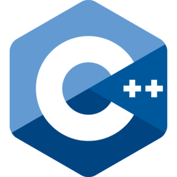

<!-- 欢迎界面并展示访问次数 -->
<h2 align="center">Thank You👋 For Your Visit ！</h2>

 

<!-- 关于我的一些生活信息 -->
## 🤵 About Me
- A postgraduate, StarCraft II and Heartstone amateur, programming enthusiast.
- I am dedicated to the distributed system and blockchain
 

<!-- 我的一些兴趣爱好信息 -->
## 💻 Hobbies
- Coding,sleeping,swimming.

<!-- Github状态 -->
## 🌋 status

<!-- Github仓库内编程语言使用情况统计 -->

<!-- 常用的编程语言 -->
Languages:
<code></code>
<code></code>
<code></code>

